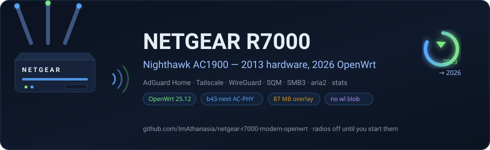
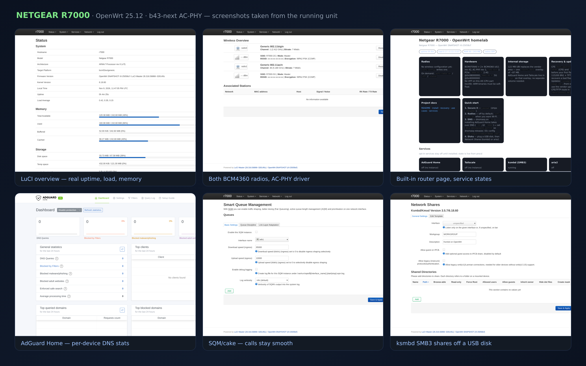

<p align="center"></p>

# Netgear R7000 — a 2013 router running a 2026 homelab stack

**Project and packaging: [@ImAthanasia](https://github.com/ImAthanasia).**
**Start here: [what this router can do now](docs/use-cases.md) — the feature list and the real-world scenarios.**

<p>
 
 
 
</p>

This is a 1 GHz Cortex-A9 with 256 MB of RAM and 128 MB of NAND — the box that shipped with
Linux 2.6 and a web UI you stopped trusting years ago. On this image it is a DNS-level ad blocker
for the whole house, a zero-port remote-access node, a VPN server, a traffic shaper, a SMB3 file
server and a per-device traffic accountant — with an open-source **b43-next AC-PHY** driver for
both BCM4360 radios and a project page inside LuCI that shows what the box is doing.

Nothing here is emulated or "demo": every number on the page is read from the unit through ubus,
and every package was built for it.

<p align="center"></p>

## Bring a dead R7000 back to life

Netgear stopped shipping firmware for this model years ago, and the last stock build runs a
2.6 kernel with no security fixes. Half the NAND is wasted by the vendor layout, and the Wi-Fi
driver is a closed Broadcom blob. The hardware is still fine — three gigabit ports, USB 3.0,
256 MB of RAM.

This build is the full recovery path:

- **CFE TFTP netboot** from a RAM-only image, so a bad flash or a dead web UI does not brick the
  box; no serial console needed ([install method B](docs/install.md)).
- **One 122 MB UBI volume** instead of the vendor leftovers, giving ~87 MB of `/overlay` — enough
  for AdGuard filters, logs and extra packages.
- **b43-next** replaces `wl` entirely: both radios work on the open driver, no proprietary
  userspace.
- **Radios off by default**, root password set, LAN on `192.168.1.28` — the box boots quiet and
  secure instead of broadcasting a default SSID.

Back up `mtd0` (CFE) and `mtd1` (nvram) before your first flash; the TFTP initramfs and serial
recovery steps are in [docs/recovery.md](docs/recovery.md).

## What this image gives you

- **Ad blocking for every device** — AdGuard Home on port 53 with DoH upstream and per-client
  stats (soft-float build linked in [docs/services.md](docs/services.md)).
- **Remote access without ports** — Tailscale (off until it has a node key) and kernel WireGuard.
- **Calls stay smooth** — SQM/cake shaping on the uplink.
- **Storage** — ksmbd SMB3 shares, aria2 downloads onto a hot-plugged disk, smartmontools.
- **Visibility** — nlbwmon per device, vnstat2 monthly totals.
- **Peripherals** — USB 3.0 storage and tethering helpers are in the image.
- **Guard rails** — banip blocklists, watchcat ping watchdog, Wi-Fi schedule, DDNS.
- **Wi-Fi on demand** — `wifi-radio on|off|status`; at boot nothing is transmitted.
- **A real project page** — *Services → ★ Router project*: radio state, hardware, service
  states, recovery steps, quick start and a Wi-Fi QR when a radio is on.
- **Branding you can see** — version string, DTS model and a footer badge on every LuCI page.

Not included (by design — licence/size): AdGuard Home and Tailscale binaries. Both have
soft-float needs on this CPU and are installed by hand; see [docs/services.md](docs/services.md).

## Use cases

| Scenario | What runs |
|---|---|
| **Resurrect a bricked or abandoned unit** | CFE TFTP initramfs → `sysupgrade -n`; stock firmware is not needed |
| **Block ads on every phone, TV and laptop** | AdGuard Home on :53, DoH upstream, dnsmasq moved to port 0 |
| **Reach home from anywhere** | Tailscale subnet router, or WireGuard in-kernel |
| **Turn a USB disk into a share / download box** | ksmbd SMB3 + aria2 + smartmontools (ext4/exfat/ntfs3 modules included) |
| **Keep video calls smooth on a busy line** | SQM with cake, per-direction shaping |
| **See who is eating the uplink** | nlbwmon per device, vnstat2 monthly totals |
| **Secure the box and forget it** | banip blocklists, watchcat ping watchdog, Wi-Fi schedule, DDNS |

The long version with before/after and exact commands is in
[docs/use-cases.md](docs/use-cases.md).

## Hardware

Read from `ubus`, `dmesg`, `/proc/mtd` and `iwinfo` on the running box.

| | |
|---|---|
| SoC | Broadcom **BCM4709A0**, ARMv7 Cortex-A9, 2 cores @ 1 GHz, **no VFP** |
| RAM | 256 MB DDR3 |
| Flash | 128 MB NAND, UBI over the full region: 122 MB → 96.8 MB `rootfs_data` → 87.6 MB `/overlay` |
| Wi-Fi | **2 × BCM4360** (3×3, 2.4 GHz + 5 GHz), d11 rev 42, AC-PHY rev 1 |
| Ethernet | 4 × GbE LAN + 1 × GbE WAN (BCM53010 switch in the SoC) |
| USB | 1 × USB 3.0 (xHCI) + 1 × USB 2.0 |
| Kernel | Linux 6.18.60, `b43-next` (no `wl`, no Broadcom userspace) |
| Default LAN | `192.168.1.28/24`, DHCP server **off** |
| Default login | `root` / `changeme` |

> **Before you connect it to anything:** change the root password, change the Wi-Fi key in
> `/etc/router-wifi.conf`, and set your own country. The image ships with a placeholder key and
> the radios **off**.

## Install

Get the images from the [v1.0.1 release](https://github.com/ImAthanasia/netgear-r7000-modern-openwrt/releases/tag/v1.0.1)
(`…-squashfs.chk` to flash, `…-initramfs.trx` for CFE netboot) and verify them:

```sh
cd release && sha256sum -c SHA256SUMS
```

| Route | When |
|---|---|
| **B — CFE TFTP netboot** | bricked box, first flash, no serial |
| **A — vendor updater** | stock Netgear firmware still working |
| **C — `sysupgrade -n`** | already on OpenWrt |

Full commands and the recovery procedures: [docs/install.md](docs/install.md) and
[docs/recovery.md](docs/recovery.md).

## Build it yourself

Short version (full details, host packages and pitfalls in [docs/build.md](docs/build.md)):

```sh
git clone https://git.openwrt.org/openwrt/openwrt.git
cd openwrt
git checkout 25058cf725f1994e5d5b4f012d321ecec5ef413d
./scripts/feeds update -a && ./scripts/feeds install -a

git -C feeds/luci apply /path/to/repo/patches/0003-luci-footer-badge.patch
cp /path/to/repo/patches/0001-mtd-bcm47xxpart-make-ML-writable.patch \
   target/linux/bcm53xx/patches-6.18/9xx-mtd-bcm47xxpart-make-ML-writable.patch
patch -p1 < /path/to/repo/patches/0002-bcm53xx-netgear-r7000-b43-next.patch

mkdir -p package/kernel/b43-next
cp -a /path/to/repo/package/b43-next/. package/kernel/b43-next/
cp -a /path/to/repo/overlay/. files/
cp /path/to/repo/config/config.r7000 .config

make defconfig && make -j"$(nproc)"
```

The result lands in
`bin/targets/bcm53xx/generic/openwrt-bcm53xx-generic-netgear_r7000-squashfs.chk`.

## Documentation

- [Use cases](docs/use-cases.md) — scenarios, before/after, exact commands.
- [Install](docs/install.md) — CFE/TFTP, vendor updater, sysupgrade.
- [Recovery](docs/recovery.md) — serial, TFTP initramfs, backups, back to stock.
- [Firmware layout](docs/firmware-layout.md) — partitions, UBI, why ML is writable.
- [Wi-Fi](docs/wifi.md) — b43-next, channels, DFS, `wifi-radio`.
- [Services](docs/services.md) — AdGuard Home, Tailscale, file sharing, DNS.
- [Build](docs/build.md) — exact toolchain and patch order.
- [Limitations](docs/limitations.md) — honest list.
- [Discoveries](docs/discoveries.md) — what this port learned.

## Provenance

- OpenWrt `b43-ac-phy` branch, commit
  `25058cf725f1994e5d5b4f012d321ecec5ef413d`
  ("mac80211: b43: add AC-PHY support from b43-ac-wip").
- `b43-next` from <https://github.com/aleferri/b43-next>,
  commit `ee7ed443dc8dde43bd2b2e9aea7d170ad5e92e1b`, GPL-2.0-only.
- Broadcom firmware `6.30.163.46` (784.2) squashed to core rev 42 / AC.

## Credits

- OpenWrt and the b43 / `b43-next` authors (see `NOTICE`).
- **ImAthanasia** — port, flash-layout work, LuCI page, packaging.

## License

Project glue (overlay scripts, docs, page, banner): MIT — see [LICENSE](LICENSE).
The firmware image aggregates GPL-2.0 and other code; see [NOTICE](NOTICE).
