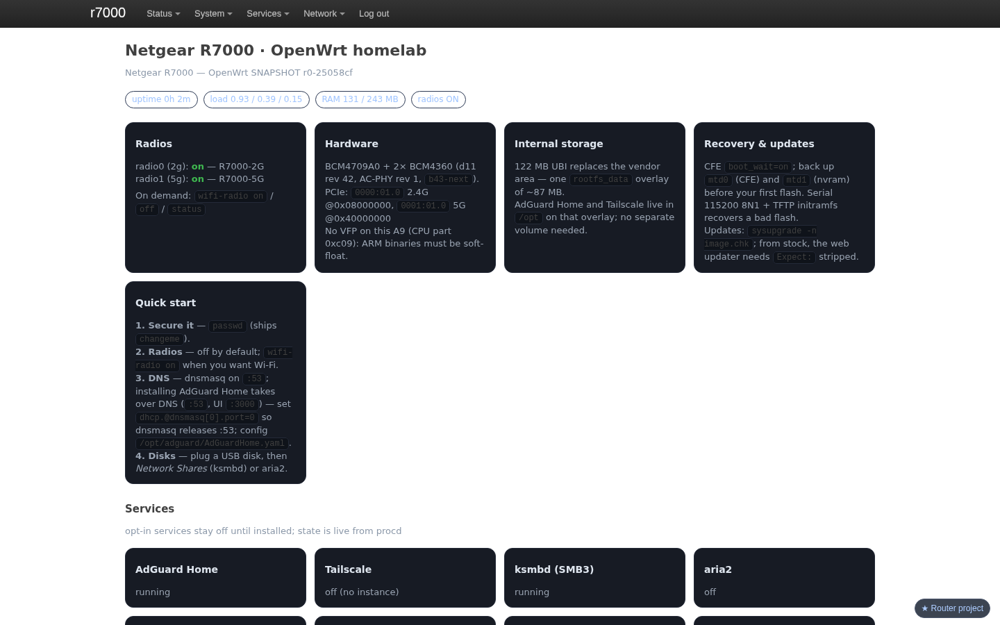

# Netgear R7000 — Modern OpenWrt

OpenWrt for the Netgear R7000 (BCM4709A0 + 2 × BCM4360) with the out-of-tree
**b43-next AC-PHY** driver, the full 122 MB NAND UBI reclaimed for a single
~87 MB overlay, and a small homelab application set. A ready-to-flash
`-squashfs.chk` is included.

| | |
|---|---|
| SoC | Broadcom BCM4709A0 (Cortex-A9, no VFP) |
| Radios | 2 × BCM4360, 3×3 (2.4 GHz + 5 GHz) |
| Wi-Fi driver | `b43-next` (AC-PHY, DFS), not vendor `wl` |
| Kernel | Linux 6.18.60 |
| Base | OpenWrt 25.12 / `b43-ac-phy` @ `25058cf7` |
| Flash | 122 MB UBI → 96.8 MB `rootfs_data` → 87.6 MB `/overlay` |
| Default LAN | `192.168.1.28/24`, DHCP server off |
| Default login | `root` / `changeme` |

<p align="center"></p>

> **Before you connect it to anything:** change the root password, change the
> Wi-Fi key in `/etc/router-wifi.conf`, and set your own country. The image
> ships with a placeholder key and the radios **off**.

## Why this exists

Netgear's stock firmware leaves the second half of the NAND unused and ships a
closed `wl` driver. This build:

- reclaims the whole 122 MB UBI area — one `rootfs_data` volume, no second
  partition, no `/mnt/flash` tricks;
- runs the open `b43-next` driver with AC-PHY support on both BCM4360 radios
  (VHT80 on 5 GHz, DFS channels);
- keeps radios **off** until you ask for them (`wifi-radio on`);
- provides a built-in **Router project** page in LuCI (status, storage, CFE
  notes, service hints) and matching screenshots;
- is unmodified OpenWrt underneath: `opkg`, firewall, DHCP, SQM, VPNs and the
  rest work as usual.

## What you get

- LuCI 25.12 with the Material and Bootstrap themes.
- `b43-next` kernel module + firmware squashed to the AC core rev (42).
- Extra tools: `iwinfo`, `ethtool`, `htop`, `socat`, `lm-sensors`, `tcpdump`,
  `mtr`, `nmap`, `aria2`, `ksmbd`, `wsdd2`, `nlbwmon`, `vnstat2`, `banip`,
  `ttyd`, `sqm-scripts`, `wifischedule`, `watchcat`, `wol`, `ddns-scripts`.
- The **Router project** LuCI page at *Services → ★ Router project*, also
  reachable at `/router.html`.
- A footer badge on every LuCI page.

Not included (by design — licence/size): AdGuard Home and Tailscale. Both have
soft-float needs on this CPU and are installed by hand; see
[docs/services.md](docs/services.md).

## Install

### From the stock Netgear firmware

1. Download `release/openwrt-bcm53xx-generic-netgear_r7000-squashfs.chk`.
2. Netgear UI → *Advanced → Administration → Firmware Update* → upload the
   `.chk`. Do not power off during the write.
3. The router comes up at **192.168.1.28** (not .1), SSH `root` / `changeme`.

If the stock uploader rejects the file or stalls, use the CFE/TFTP route in
[docs/install.md](docs/install.md). The image carries the Netgear board id
`U12H270T00_NETGEAR`, so its own updater accepts it as a valid `.chk`.

### From OpenWrt (including this image)

```sh
scp openwrt-bcm53xx-generic-netgear_r7000-squashfs.chk root@192.168.1.28:/tmp/
ssh root@192.168.1.28
sysupgrade -n /tmp/openwrt-bcm53xx-generic-netgear_r7000-squashfs.chk
```

`-n` wipes the overlay and gives you the documented first-boot state.

## First boot

```sh
ssh root@192.168.1.28          # password: changeme
passwd                          # do this first

vi /etc/router-wifi.conf        # SSID, KEY, COUNTRY, channels
wifi-radio on                   # radios are off by default
wifi-radio status
```

Dual-band APs come up as `<SSID>-2G` (HT20) and `<SSID>-5G` (VHT80/DFS).
The service stays enabled across reboots once you run `wifi-radio on`.

## Repository layout

```
config/       full .config and the minimal diffconfig used for this image
docs/         install, recovery, layout, Wi-Fi, services, build, limits
images/       screenshots of this exact build
overlay/      files/ overlay (board-neutral; see overlay/README.md)
package/      package/kernel/b43-next (pinned upstream)
patches/      bcm53xx patches, R7000 image Makefile change, LuCI badge
release/      flashable .chk, package manifest, SHA256SUMS
```

## Build it yourself

Short version (full details, host packages and pitfalls in
[docs/build.md](docs/build.md)):

```sh
git clone https://git.openwrt.org/openwrt/openwrt.git
cd openwrt
git checkout 25058cf725f1994e5d5b4f012d321ecec5ef413d
./scripts/feeds update -a && ./scripts/feeds install -a

git -C feeds/luci apply /path/to/repo/patches/0003-luci-footer-badge.patch
cp /path/to/repo/patches/0001-mtd-bcm47xxpart-make-ML-writable.patch \
   target/linux/bcm53xx/patches-6.18/9xx-mtd-bcm47xxpart-make-ML-writable.patch
patch -p1 < /path/to/repo/patches/0002-bcm53xx-netgear-r7000-b43-next.patch

mkdir -p package/kernel/b43-next
cp -a /path/to/repo/package/b43-next/. package/kernel/b43-next/
cp -a /path/to/repo/overlay/. files/
cp /path/to/repo/config/config.r7000 .config

make defconfig && make -j"$(nproc)"
```

The result lands in
`bin/targets/bcm53xx/generic/openwrt-bcm53xx-generic-netgear_r7000-squashfs.chk`.

## Documentation

- [Install](docs/install.md) — stock firmware, web UI, CFE/TFTP, sysupgrade.
- [Recovery](docs/recovery.md) — serial, TFTP initramfs, backups.
- [Firmware layout](docs/firmware-layout.md) — partitions, UBI, why the ML
  partition is writable.
- [Wi-Fi](docs/wifi.md) — b43-next, channels, DFS, `wifi-radio`.
- [Services](docs/services.md) — AdGuard Home, Tailscale, file sharing, DNS.
- [Build](docs/build.md) — exact toolchain and patch order.
- [Limitations](docs/limitations.md) — honest list.
- [Discoveries](docs/discoveries.md) — what this port learned.

## Provenance

- OpenWrt `b43-ac-phy` branch, commit
  `25058cf725f1994e5d5b4f012d321ecec5ef413d`
  ("mac80211: b43: add AC-PHY support from b43-ac-wip").
- `b43-next` from <https://github.com/aleferri/b43-next>,
  commit `ee7ed443dc8dde43bd2b2e9aea7d170ad5e92e1b`, GPL-2.0-only.
- Broadcom firmware `6.30.163.46` (784.2) squashed to core rev 42 / AC.

## Credits

- OpenWrt and the b43 / `b43-next` authors (see `NOTICE`).
- **ImAthanasia** — port, flash-layout work, LuCI page, packaging.

## License

Project glue (overlay scripts, docs, page): MIT — see [LICENSE](LICENSE).
The firmware image aggregates GPL-2.0 and other code; see [NOTICE](NOTICE).
